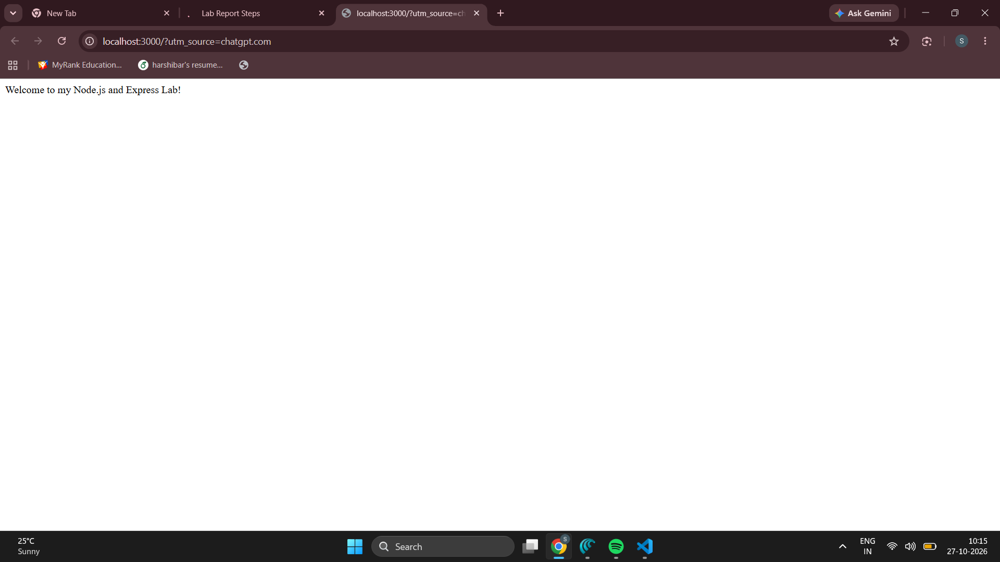
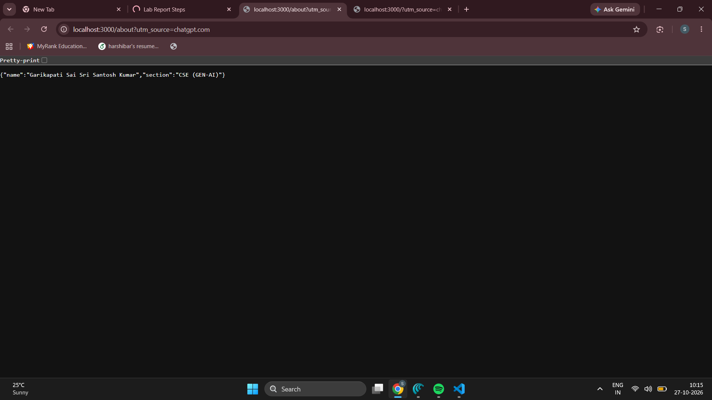
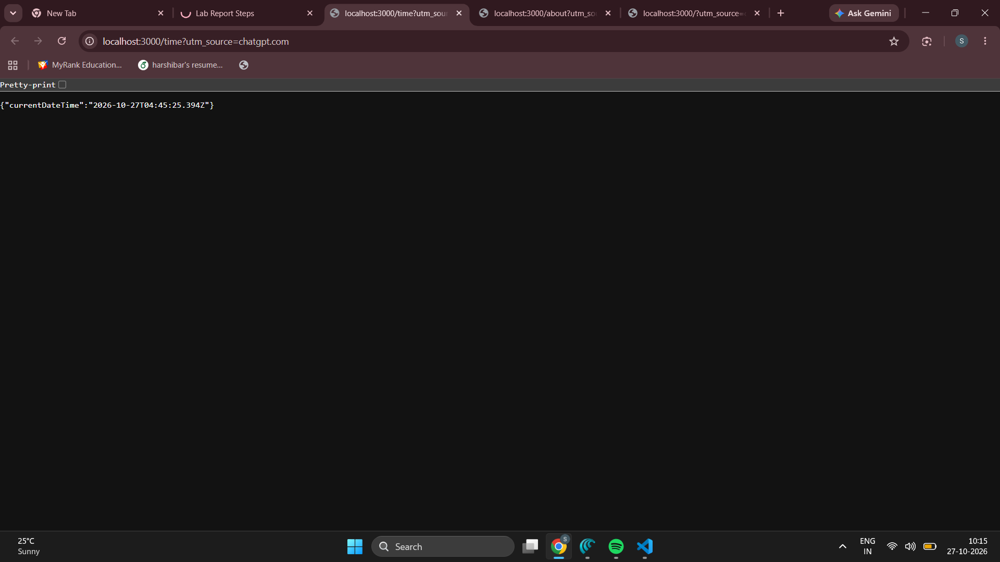
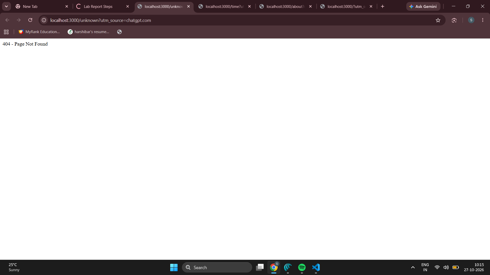

# Lab 1: Node.js and Express server

## Student Details
- Name: Garikapati Sai Sri Santosh Kumar
- Registration Number: 252U1R9038
- Section: CSE (GEN-AI)2A

## Live Link
(https://bdf-lab-01-ten.vercel.app)

## Objective
To create a basic server using Node.js's built-in HTTP module
and build an Express server with multiple routes and
appropriate HTTP status codes.

## Technologies Used
- Node.js
- Express.js
- JavaScript
- npm

## Installation and Setup

### Prerequisites
- Node.js and npm installed

### Install Dependencies
Open the lab-01 folder in the terminal and run:

    npm install

### Start the Express Server

    npm start

Open http://localhost:3000 in your browser.

### Run the Basic HTTP Server

Stop the Express server with Ctrl+C, then run:

    node server-http.js

Open http://localhost:3000 to test the basic server.
Stop it with Ctrl+C before starting the Express server again.

## Endpoints

| Method | Path | Description | Status |
|---|---|---|---|
| GET | / | Displays a welcome message | 200 |
| GET | /about | Returns name and section as JSON | 200 |
| GET | /time | Returns current date and time | 200 |
| GET | /unknown | Demonstrates the 404 response | 404 |

## Screenshots

### Home Route

### About Route

### Time Route

### Unknown Route

## Problems Faced and Solutions

Problem: Invalid JSON syntax in package.json.

Solution: Corrected the JSON syntax and verified that
the server starts successfully using npm start.

## Conclusion

Successfully created a basic Node.js HTTP server and an
Express server with three routes and a 404 handler.
Verified the HTTP response status codes.
